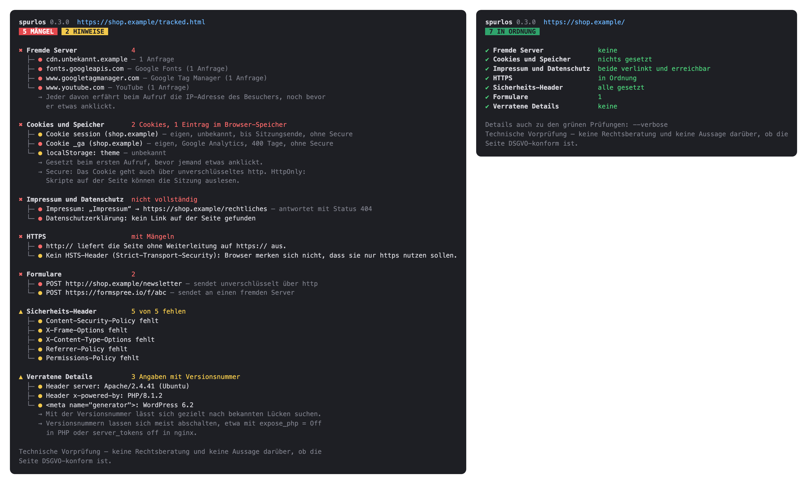

<h1>
  <picture>
    <source media="(prefers-color-scheme: dark)" srcset="assets/logo-dark.svg">
    
  </picture>
</h1>

[Deutsch](README.md) · **English**

*spurlos* is German for “without a trace”. It opens a website the way a first-time visitor does, before clicking anything, and shows you:

- **which third-party servers** get requests, such as Google Fonts, Tag Manager, YouTube or a CDN. Each of them learns the visitor's IP address.
- **which cookies and browser storage entries** are set before any consent, and whether known trackers or third-party cookies are among them.
- whether the **legal notice (Impressum) and privacy policy** are linked and open.
- whether **HTTPS** is set up properly: certificate, redirect from http, HSTS.
- which **security headers** are missing.
- where **forms** send their data: encrypted to the site itself, to a third-party server, or unencrypted.
- whether headers or the page **reveal the software behind it, version included**, e.g. `X-Powered-By: PHP/8.1.2` or `WordPress 6.2`.

```
npx spurlos example-company.com --lang en
```

On the left a page with problems, on the right a clean one:



The full reports for both pages, as text in German and English and as JSON, are in [`examples/`](examples/), along with an HTML page each. Both pages come from the tests and run offline as `https://shop.example`; `pnpm examples` regenerates everything.

spurlos uses a real browser (Chromium via Playwright), so it also finds requests and cookies that only JavaScript creates. It opens the legal notice, the privacy policy and the http address separately; those visits do not count towards the page's requests and cookies. Whether http redirects to https is asked of the server directly rather than through the browser, since Chromium switches to https on its own.

## Installation

With Docker, no Node needed:

```
docker run --rm ghcr.io/mmohrx/spurlos example-company.com --lang en
```

Or with Node.js 22 or later. The first time, Playwright needs its browser:

```
npx playwright install chromium-headless-shell
npx spurlos <url> --lang en
```

| Option | |
|---|---|
| `--lang de\|en` | language of the report. Without it, `SPURLOS_LANG` applies, then the system language (`LC_ALL`, `LC_MESSAGES`, `LANG`), else `de` |
| `--verbose`, `-v` | details for the green checks too |
| `--json` | the full result as JSON |
| `--html` | the report as a self-contained HTML page, e.g. to pass on |
| `--pdf` | the report as a PDF |
| `-o`, `--output <file>` | the report into a file instead of the output. Without `--json`, `--html` or `--pdf` the extension decides: `spurlos example.com -o report.pdf` (`.pdf`, `.html`, `.json`, else text) |
| `--auth <user:password>` | login by HTTP basic auth, e.g. for a staging site. Better through `SPURLOS_AUTH`, see [Sites behind a login](#sites-behind-a-login) |
| `--user-agent <string>` | your own user agent for every request |
| `--help`, `-h` | help |

The summary comes first, then the checks, red ones first. Red and yellow checks list every finding, green ones take a single line. In a terminal the report is colored; with `-o`, in a pipe or with `NO_COLOR` set, it stays plain text. `--html` and `--pdf` go to the output too (`--pdf > report.pdf`), but spurlos does not write a PDF into the terminal. With Docker a file of `-o` stays in the container; redirect instead: `docker run --rm ghcr.io/mmohrx/spurlos example.com --pdf > report.pdf`.

## Lights

| Check | 🟢 | 🟡 | 🔴 |
|---|---|---|---|
| Third-party servers | none | – | at least one request to another domain |
| Cookies and storage | nothing set, or only known session and security cookies | first-party cookies or entries spurlos does not know; a cookie without `Secure` on an https page; a session cookie without `HttpOnly` | a third-party cookie or one of a known tracker |
| Legal notice and privacy policy | both linked and reachable | – | a link is missing or the page answers with an error |
| HTTPS | https, http redirects, HSTS, certificate valid for 14 days or more | no HSTS (or `max-age=0`), nothing answers on http, certificate valid for less than 14 days | no https, http without redirect, certificate valid for less than 7 days or expired |
| Security headers | all set | one or more missing | – |
| Forms | none, or all send encrypted to the site itself | one sends to a third-party server | one sends unencrypted over http |
| Software details | nothing, or only the software's name | a version number in `Server`, `X-Powered-By`, `X-AspNet-Version`, `X-AspNetMvc-Version`, `X-Generator` or `<meta name="generator">` | – |

The headers checked are `Content-Security-Policy`, `X-Frame-Options` (or `frame-ancestors` in the CSP), `X-Content-Type-Options: nosniff`, `Referrer-Policy` and `Permissions-Policy`. CSP and Referrer-Policy also count as a `<meta>` tag, for hosts like GitHub Pages where headers cannot be set. spurlos recognizes the legal notice and privacy policy by link text or address, in German and English. A link like “Impressum & Datenschutz” counts for both.

Every finding in the report has its own light, and the check gets the worst of them. That way you see which entry makes a check yellow or red.

Known session and security cookies include `XSRF-TOKEN` and `<app>-session` from Laravel, `PHPSESSID`, `JSESSIONID`, `csrftoken` from Django and `__cf_bm` from Cloudflare. In browser storage, spurlos knows entries that frameworks create themselves, such as Vue Router's scroll positions (`vue-router:scroll`). The list is in `src/services.json` (category `necessary`).

Subdomains count as the site itself (`cdn.company.com` belongs to `www.company.com`), following the Public Suffix List (`company.co.uk`).

## How spurlos visits

spurlos opens the page itself as a regular Chrome and adds its name to the user agent:

```
Mozilla/5.0 (X11; Linux x86_64) AppleWebKit/537.36 (KHTML, like Gecko) Chrome/159.0.0.0 Safari/537.36 spurlos/0.3.0
```

“HeadlessChrome” is left out on purpose, in the client hints (`sec-ch-ua`) too. Many cookie banners and trackers do not load at all for visits they take for bots. spurlos would then report a clean page while real visitors get tracked. It does not hide, though: its name is in every user agent, and `navigator.webdriver` stays `true`.

The legal notice, the privacy policy and the http redirect are requested openly as a bot, since bot detection changes nothing there:

```
spurlos/0.3.0 (+https://github.com/mmohrx/spurlos)
```

Because spurlos opens pages it does not know, Chromium runs in its own sandbox wherever the system allows one (macOS, Windows, Linux with user namespaces). Without one, spurlos says so on stderr. In the Docker image Chromium runs without its sandbox, as the container, running as user `node`, is the boundary; on Linux, that is the best way to check unknown sites. spurlos accepts no downloads from a page.

The HTML report holds every finding, with the green checks folded. It loads nothing and contains no JavaScript, so it opens offline and can be sent by mail. The PDF is the same report, printed by the Chromium spurlos uses anyway, on A4 and always light. While printing, JavaScript is off and every request is blocked.

## For AI assistants (MCP)

`spurlos mcp` starts an [MCP](https://modelcontextprotocol.io) server over stdio. An assistant like Claude can then check sites itself, e.g. when asked “Check example.com and explain what is red”. The server offers one tool, `scan`, with `url` and optionally `lang` (`de`, `en`) and `format` (`text` or `json`). It runs on your machine, like the CLI: the assistant starts it itself and talks to it over stdin and stdout. There is no open port, so it needs no token either.

In Claude Code:

```
claude mcp add spurlos -- npx spurlos mcp
```

In other clients, e.g. Claude Desktop, under `mcpServers`:

```json
{ "spurlos": { "command": "npx", "args": ["spurlos", "mcp"] } }
```

With Docker instead of Node: `"command": "docker", "args": ["run", "-i", "--rm", "ghcr.io/mmohrx/spurlos", "mcp"]`.

As with the CLI, the language follows `--lang`, `SPURLOS_LANG` or the system, and `--user-agent` applies to every request. There is no `--auth` there, as the assistant picks the addresses. At most two checks run at a time, others wait. Every report carries the note that it is not legal advice.

## Sites behind a login

Internal sites and staging sites before launch often sit behind HTTP basic auth. Pass the credentials through the environment, so they stay out of the shell history and the process list:

```
SPURLOS_AUTH='team:secret' npx spurlos https://staging.company.com
```

`--auth team:secret` works too and takes precedence. The password goes only to exactly the address given (scheme, host, port). Third-party servers the page loads never get it, even when they ask for a login, and Impressum or privacy pages only when they live at the same address. If `company.com` redirects to `www.company.com`, give `www.company.com` right away. The check whether http redirects to https runs without the login. If the address itself is `http://`, the password goes unencrypted; spurlos points that out on stderr.

If the page asks for a login and there is none or the wrong one, spurlos does not check the error page but ends with exit code `2` and says why.

## In CI

```
npx spurlos https://staging.company.com --lang en || echo "new traces"
```

Exit code `0` without a red finding, `1` with one, `2` if the page could not be checked or the call was wrong (unknown option, invalid URL, unknown language, more than one of `--json`, `--html`, `--pdf`) or the file of `-o` could not be written. A missing or rejected login ends with `2` too.

With `--json` you get the full result as JSON: `scan` holds the raw data (every request, cookies, storage, headers, certificate, links, forms), `results` one object per check with `check` (`third-party`, `cookies`, `legal`, `https`, `headers`, `forms`, `disclosure`), `level` (`green`, `yellow`, `red`) and the findings, `note` the note that this is not legal advice. The red checks, for example:

```
npx spurlos https://staging.company.com --json | jq -r '.results[] | select(.level == "red") | .check'
```

## Adding known services

Which hosts and cookies belong to which service is in [`src/services.json`](src/services.json). Hosts include their subdomains, cookie names match as a prefix (`_ga` also covers `_ga_ABC123`), with a leading `*` as a suffix (`*-session`). If a service is missing, a pull request is welcome.

## What spurlos does not do

- It does not actively look for holes. It only evaluates what a normal visit to the page returns anyway; it never requests addresses like `/.env`, `/.git/` or `/phpinfo.php`. So you can run it against any site without probing it.
- It does not click the cookie banner. What it checks is the state before the visitor decides anything.
- It does not read the legal notice or privacy policy, it only checks that they are linked and reachable.
- It is not legal advice. A green report does not mean a site complies with the GDPR, and a red one does not mean it doesn't.

## Development

```
pnpm install
pnpm exec playwright install chromium-headless-shell
pnpm test        # unit and browser tests against test/sites, no network
pnpm typecheck
pnpm build       # to dist/
node src/cli.ts <url>
```

## Contributing

A service is missing, a light seems wrong, or you have an idea: [`CONTRIBUTING.md`](CONTRIBUTING.md) explains how to contribute (in German; issues and pull requests in English are welcome). Please report security holes not as an issue but as described in [`SECURITY.md`](SECURITY.md).

## License

MIT, © 2026 Martin Mohr
