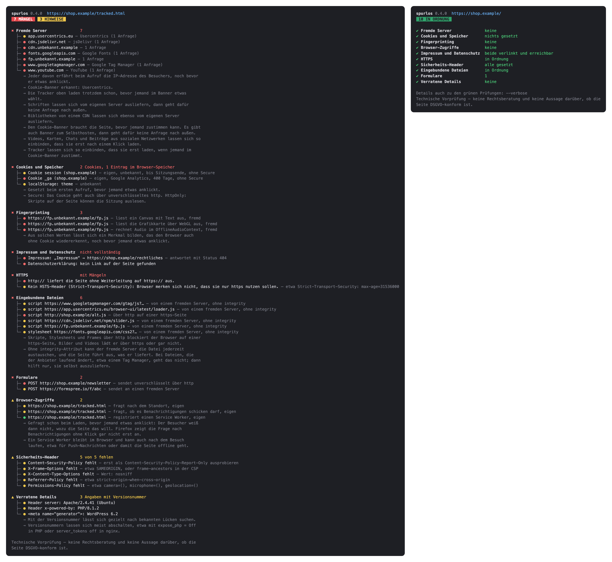

<h1>
  <picture>
    <source media="(prefers-color-scheme: dark)" srcset="assets/logo-dark.svg">
    
  </picture>
</h1>

**Deutsch** · [English](README.en.md)

Ruft eine Website so auf wie ein neuer Besucher, der noch nichts angeklickt hat, und zeigt dir:

- **welche fremden Server** dabei angefragt werden, etwa Google Fonts, Tag Manager, YouTube oder ein CDN. Jeder davon erfährt die IP-Adresse des Besuchers.
- **welche Cookies und Einträge im Browser-Speicher** schon vor jeder Einwilligung gesetzt sind, und ob darunter bekannte Tracker oder Cookies fremder Domains sind.
- welcher **Cookie-Banner** geladen wird, etwa Usercentrics, Cookiebot oder Borlabs, und ob Tracker trotzdem schon vorher laden.
- ob **Impressum und Datenschutzerklärung** verlinkt sind und sich öffnen lassen.
- ob **HTTPS** sauber eingerichtet ist: Zertifikat, Weiterleitung von http, HSTS.
- welche **Sicherheits-Header** fehlen, und ob die Content-Security-Policy Skripte doch durchlässt.
- ob **eingebundene Dateien** über unverschlüsseltes http kommen, und ob fremde Skripte und Stylesheets ohne `integrity` eingebunden sind.
- wohin **Formulare** senden: verschlüsselt an die eigene Seite, an einen fremden Server oder unverschlüsselt.
- ob Header oder Seite **die Software dahinter samt Version** verraten, etwa `X-Powered-By: PHP/8.1.2` oder `WordPress 6.2`.

```
npx spurlos beispiel-firma.de
```

Links eine Seite mit Mängeln, rechts eine saubere:



Die vollständigen Berichte beider Seiten, als Text auf Deutsch und Englisch und als JSON, liegen in [`examples/`](examples/), dazu je eine HTML-Seite. Beide Seiten stammen aus den Tests und laufen offline unter `https://shop.example`; `pnpm examples` erzeugt alles neu.

spurlos nutzt einen echten Browser (Chromium über Playwright). Es findet also auch Anfragen und Cookies, die erst per JavaScript entstehen. Impressum, Datenschutzerklärung und die http-Adresse ruft es getrennt davon auf; diese Aufrufe zählen nicht zu den Anfragen und Cookies der Seite. Ob http auf https weiterleitet, fragt es direkt beim Server und nicht über den Browser nach, denn Chromium wechselt von sich aus auf https.

Mit welcher Browserkennung spurlos die Seite aufruft und wie es mit Bot-Schutz und Anmeldungen umgeht, steht in [docs/de/how-it-works.md](docs/de/how-it-works.md).

## Installation

Mit Docker, ohne Node:

```
docker run --rm ghcr.io/mmohrx/spurlos beispiel-firma.de
```

Oder mit Node.js 22 oder neuer. Beim ersten Mal braucht Playwright seinen Browser:

```
npx playwright install chromium-headless-shell
npx spurlos <url>
```

| Option | |
|---|---|
| `<url> …` | eine oder mehrere Adressen; mehrere prüft spurlos nacheinander, mit je einem Bericht |
| `--lang de\|en` | Sprache des Berichts. Ohne Angabe gilt `SPURLOS_LANG`, dann die Sprache des Systems (`LC_ALL`, `LC_MESSAGES`, `LANG`), sonst `de` |
| `--verbose`, `-v` | Details auch zu den grünen Prüfungen |
| `--json` | vollständiges Ergebnis als JSON |
| `--html` | Bericht als eigenständige HTML-Seite, etwa zum Weiterschicken |
| `--pdf` | Bericht als PDF |
| `-o`, `--output <datei>` | Bericht in eine Datei statt auf die Ausgabe. Ohne `--json`, `--html` oder `--pdf` entscheidet die Endung: `spurlos firma.de -o bericht.pdf` (`.pdf`, `.html`, `.json`, sonst Text). Mehrmals angegeben, schreibt ein Lauf mehrere Formate: `-o bericht.json -o bericht.html`; dann entscheidet bei jeder Datei die Endung, `--json`, `--html` und `--pdf` gehen damit nicht |
| `--baseline <datei>` | mit einer früheren Ausgabe von `--json` vergleichen, siehe [In der CI](docs/de/ci.md) |
| `--auth <benutzer:passwort>` | Anmeldung per HTTP Basic Auth, etwa für eine Staging-Seite. Besser über `SPURLOS_AUTH`, siehe [Seiten hinter einer Anmeldung](docs/de/how-it-works.md#seiten-hinter-einer-anmeldung) |
| `--user-agent <kennung>` | eigene Browserkennung für alle Aufrufe |
| `--own <host>` | Server, die zur Seite gehören, obwohl sie auf einer anderen Domain liegen, etwa ihr CDN: `--own cdn-firma.net`, samt Subdomains; mehrmals oder mit Komma. Siehe [Eigene Server auf anderen Domains](docs/de/checks.md#eigene-server-auf-anderen-domains) |
| `--help`, `-h` | Hilfe |

Oben steht die Bilanz, darunter die Prüfungen mit den roten zuerst. Rote und gelbe Prüfungen zeigen jeden Befund, grüne nur eine Zeile. Wo es einen gängigen Weg gibt, nennt der Bericht ihn gleich mit, etwa Schriften selbst auszuliefern oder einen Beispielwert für einen fehlenden Header. Das sind technische Hinweise, keine Rechtsberatung. Im Terminal ist der Bericht farbig. Mit `-o`, in einer Pipe oder mit `NO_COLOR` bleibt es reiner Text. `--html` und `--pdf` gehen auch über die Ausgabe (`--pdf > bericht.pdf`), ein PDF schreibt spurlos aber nicht ins Terminal. Mit Docker landet eine Datei von `-o` im Container; dort leitest du besser um: `docker run --rm ghcr.io/mmohrx/spurlos firma.de --pdf > bericht.pdf`.

| Umgebungsvariable | |
|---|---|
| `SPURLOS_LANG` | Sprache des Berichts, wenn `--lang` fehlt |
| `SPURLOS_AUTH` | Anmeldung als `benutzer:passwort`, wenn `--auth` fehlt, siehe [Seiten hinter einer Anmeldung](docs/de/how-it-works.md#seiten-hinter-einer-anmeldung) |
| `SPURLOS_NO_SANDBOX` | `1` startet Chromium gleich ohne Sandbox und ohne Hinweis darauf; das Docker-Image setzt das, dort ist der Container die Grenze |
| `NO_COLOR` | keine Farben, auch im Terminal |

Die Seite selbst darf bis zu 30 Sekunden zum Laden brauchen. Danach wartet spurlos bis zu 10 Sekunden, bis sie nichts mehr nachlädt; lädt sie dann noch, sagt der Bericht das. Impressum, Datenschutzerklärung und die Anfrage über http bekommen je 15 Sekunden.

spurlos selbst meldet nichts nach Hause: keine Telemetrie, keine Statistik. Angefragt wird nur die Seite, die du prüfst, samt allem, was sie selbst nachlädt.

## Ampel

| Prüfung | 🟢 | 🟡 | 🔴 |
|---|---|---|---|
| Fremde Server | keine | nur Cookie-Banner und Captchas (Kategorien `consent` und `captcha`): Die Seite braucht sie, sie erfahren die IP-Adresse trotzdem; dazu Server, die zur Seite zu gehören scheinen (`--own`, Zertifikat, Name), und die der Plattform, auf der sie läuft (Wix, Shopify, Squarespace, Webflow, IONOS MyWebsite) | mindestens eine Anfrage an eine andere Domain, die zu keinem Cookie-Banner, keinem Captcha und nicht zur Seite gehört |
| Cookies und Speicher | nichts gesetzt, oder nur bekannte Sitzungs- und Sicherheits-Cookies und solche, in denen der Cookie-Banner die Wahl speichert | eigene Cookies oder Einträge, die spurlos nicht kennt oder die zu einem Dienst wie einem Chat oder Zahlungsanbieter gehören; ein Cookie ohne `Secure` auf einer https-Seite; ein Sitzungs-Cookie ohne `HttpOnly` | Cookie einer fremden Domain, die nicht zur Seite zu gehören scheint, oder eines bekannten Trackers |
| Impressum und Datenschutz | beide verlinkt und erreichbar | eine Seite weist spurlos ab (`401`, `403`, `429`) oder antwortet nicht vor dem Timeout, oft ein Bot-Schutz | ein Link fehlt oder die Seite antwortet mit einem anderen Fehler, etwa `404`; ein PDF zählt als erreichbar |
| HTTPS | https, http leitet weiter, HSTS, Zertifikat noch 14 Tage oder länger gültig | kein HSTS (oder `max-age=0`), über http antwortet nichts oder nur ein Fehler (4xx, 5xx, oft ein Bot-Schutz), Zertifikat weniger als 14 Tage gültig | kein https, http ohne Weiterleitung, Zertifikat weniger als 7 Tage gültig oder abgelaufen |
| Sicherheits-Header | alle gesetzt | einer oder mehrere fehlen; die CSP lässt Skripte durch | – |
| Eingebundene Dateien | keine Auffälligkeiten | Skript oder Stylesheet eines fremden Servers ohne `integrity`; Bild, Video oder Audio über http auf einer https-Seite | Skript, Stylesheet oder iframe über http auf einer https-Seite |
| Formulare | keine oder alle senden verschlüsselt an die eigene Seite | eines sendet an einen fremden Server | eines sendet unverschlüsselt über http |
| Verratene Details | nichts, oder nur der Name der Software | eine Versionsnummer in `Server`, `X-Powered-By`, `X-AspNet-Version`, `X-AspNetMvc-Version`, `X-Generator` oder `<meta name="generator">` | – |

Die genauen Regeln stehen in [docs/de/checks.md](docs/de/checks.md): welche Header geprüft werden, welche Cookies spurlos kennt, wann ein Server auf einer anderen Domain zur Seite gehört und woran es die Plattform erkennt, auf der die Seite läuft.

## Für KI-Assistenten (MCP)

`spurlos mcp` startet einen [MCP](https://modelcontextprotocol.io)-Server über stdio. Ein Assistent wie Claude kann damit selbst Seiten prüfen, etwa auf die Bitte „Prüf mal firma.de und erklär mir, was rot ist“. Der Server bietet ein Werkzeug, `scan`, mit `url` und optional `lang` (`de`, `en`), `format` (`text` oder `json`) und `own` (eine Liste von Hostnamen wie bei `--own`). Er läuft auf deinem Rechner, wie die CLI: Der Assistent startet ihn selbst und spricht über stdin und stdout mit ihm. Einen offenen Port gibt es nicht, deshalb braucht er auch kein Token.

In Claude Code:

```
claude mcp add spurlos -- npx spurlos mcp
```

In anderen Clients, etwa Claude Desktop, unter `mcpServers`:

```json
{ "spurlos": { "command": "npx", "args": ["spurlos", "mcp"] } }
```

Mit Docker statt Node: `"command": "docker", "args": ["run", "-i", "--rm", "ghcr.io/mmohrx/spurlos", "mcp"]`.

Die Sprache richtet sich wie bei der CLI nach `--lang`, `SPURLOS_LANG` oder dem System, `--user-agent` gilt für alle Aufrufe. `--auth` gibt es dort nicht, denn die Adressen wählt der Assistent. Höchstens zwei Prüfungen laufen gleichzeitig, weitere warten. Jeder Bericht trägt den Hinweis, dass er keine Rechtsberatung ist.

## In der CI

```
npx spurlos https://staging.firma.de || echo "neue Spuren"
```

Exit-Code `0` ohne roten Befund, `1` mit rotem Befund, `2`, wenn sich eine Seite nicht prüfen ließ oder der Aufruf falsch war. Alle Fälle, das JSON von `--json`, der Vergleich mit einer Baseline und die GitHub Action stehen in [docs/de/ci.md](docs/de/ci.md).

## Bekannte Dienste ergänzen

Welche Hosts und Cookies zu welchem Dienst gehören, steht in [`src/services.json`](src/services.json). Hosts gelten samt Subdomains, Cookie-Namen als Anfang (`_ga` deckt auch `_ga_ABC123` ab), mit `*` vorn als Ende (`*-session`). Unter `paths` stehen Teile von Dateipfaden, an denen spurlos einen Dienst auch auf der eigenen Seite oder auf einem unbekannten Host erkennt: mit `/` am Ende ein Verzeichnis irgendwo im Pfad (`/wp-content/plugins/borlabs-cookie/`), sonst das Ende des Pfads (`/klaro.js`). Fehlt ein Dienst, freue ich mich über einen Pull Request.

## Was spurlos nicht tut

- Es sucht nicht aktiv nach Lücken. Ausgewertet wird nur, was ein normaler Aufruf der Seite ohnehin liefert; Adressen wie `/.env`, `/.git/` oder `/phpinfo.php` fragt spurlos nicht ab. So lässt es sich gegen jede Seite laufen, ohne sie abzuklopfen.
- Es klickt keinen Cookie-Banner an. Geprüft wird der Zustand vor jeder Entscheidung des Besuchers; welcher Banner geladen wird, nennt spurlos, aber nicht, ob er richtig eingestellt ist.
- Es liest Impressum und Datenschutzerklärung nicht, sondern prüft nur, ob sie verlinkt und erreichbar sind.
- Es gibt keine Rechtsberatung. Ein grüner Bericht heißt nicht, dass eine Seite DSGVO-konform ist, und ein roter nicht, dass sie es nicht ist.

## Entwickeln

```
pnpm install
pnpm exec playwright install chromium-headless-shell
pnpm test        # Unit-Tests und Browser-Tests gegen test/sites, ohne Netz
pnpm typecheck
pnpm build       # nach dist/
node src/cli.ts <url>
```

## Mitmachen

Fehlt ein Dienst, stimmt eine Ampel nicht oder hast du eine Idee: In [`CONTRIBUTING.md`](CONTRIBUTING.md) steht, wie du beiträgst. Sicherheitslücken bitte nicht als Issue, sondern wie in [`SECURITY.md`](SECURITY.md) beschrieben melden.

## Unterstützen

spurlos ist ein Hobbyprojekt. Wenn es dir hilft, kannst du es auf [Ko-fi](https://ko-fi.com/mmohrx) oder über [GitHub Sponsors](https://github.com/sponsors/mmohrx) unterstützen. Die Hilfe (`spurlos --help`) verlinkt in der letzten Zeile auch dorthin; die Berichte nicht, die gehören dir.

## Lizenz

MIT, © 2026 Martin Mohr
